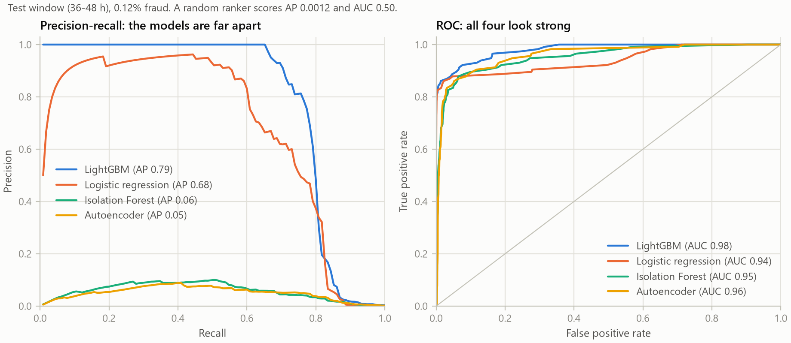

# Fraud detection with drift monitoring

A fraud detector for card payments that also watches itself. It flags suspicious transactions, measures whether its inputs, its outputs and its accuracy are drifting, and raises a retrain flag when they are.

It is built on the [ULB credit card fraud dataset](https://www.kaggle.com/datasets/mlg-ulb/creditcardfraud): 284,807 transactions over 48 hours, 0.17% of them fraud. The model trains on day 1 and is tested and monitored on day 2.

- **Write-up:** [REPORT.md](REPORT.md) covers the approach, the key decisions, the results and the limits.
- **Every result as a table:** [reports/summary.md](reports/summary.md), generated from the JSON in [reports/metrics/](reports/metrics/).

## Results at a glance

- **Supervised beats unsupervised by a wide margin, and ROC-AUC hides it.** On the test window LightGBM reaches a PR-AUC of 0.785 (95% interval 0.70 to 0.85), logistic regression 0.68, Isolation Forest 0.06 and an autoencoder 0.05. All four have a ROC-AUC between 0.94 and 0.98.
- **Rebalancing did not help the strong model.** LightGBM scored 0.789 with no rebalancing, 0.794 with class weights, 0.746 with SMOTE and 0.749 with undersampling. The last three overstate fraud probability by 3 to 54 times.
- **A cost-based threshold removes 66% of the fraud cost on test**, but the choice is fragile: pricing a false alarm at EUR 10 instead of EUR 5 moves the best threshold from 0.0085 to 0.62.
- **The dataset contains real drift, and most of it is harmless.** Between day 1 and day 2, 8 of 29 features cross the usual PSI bound of 0.25, yet they carry 6% of the model's importance. The monitor warns, then flags a retrain when alert volume doubles. Retraining cut total cost by 6% to 9%.
- **On injected drift the monitor stayed quiet on the control and flagged the harmful cases.** A new fraud tactic that cut recall from 0.84 to 0.32 moved no label-free signal and was caught only once labels arrived.



## Setup

Tested with Python 3.11 on Windows 11. Dependencies are pinned in `requirements.txt`.

```bash
python -m venv .venv
.venv\Scripts\activate          # Windows
# source .venv/bin/activate     # macOS or Linux
pip install -r requirements.txt
```

The largest dependency is PyTorch, used only for the autoencoder. On Linux, installing it first with `pip install torch==2.13.0 --index-url https://download.pytorch.org/whl/cpu` should avoid the much larger GPU build; that path was not tested here.

## Reproduce the results

```bash
python -m fraudmon all
```

This runs three stages and takes about 15 minutes on a laptop CPU (Intel i5-13500H):

1. **`data`** downloads the CSV (150 MB) from a public mirror and checks its md5.
2. **`train`** compares the imbalance strategies, then fits the final models and saves them to `models/`.
3. **`evaluate`** recomputes every metric, figure and table.

If the download fails, get `creditcard.csv` from the Kaggle page above and put it at `data/creditcard.csv`. The loader checks the row and fraud counts before using it.

## Re-run the evaluation

```bash
python -m fraudmon evaluate
```

This reloads the saved models and rewrites everything under `reports/` without refitting them. It takes about 8 minutes, most of it in the simulations, which refit models as part of what they measure.

Each stage can also be run on its own:

| Command | What it does | Time |
|---|---|---|
| `python -m fraudmon data` | Download, verify, summarise the data | 1 to 2 min |
| `python -m fraudmon train` | Imbalance comparison, final models, out-of-fold reference scores | 6.5 min |
| `python -m fraudmon compare` | Supervised and unsupervised models on validation and test | 15 s |
| `python -m fraudmon threshold` | Cost-based threshold, sensitivity grid, calibration | 5 s |
| `python -m fraudmon drift` | Natural drift, false-alarm control, monitor on day 2 | 1 min |
| `python -m fraudmon simulate` | Injected scenarios, new-tactic visibility, retrain policies | 6 min |
| `python -m fraudmon plots` | Figures, from the metrics JSON only | 10 s |
| `python -m fraudmon summary` | `reports/summary.md`, from the metrics JSON only | 1 s |

`threshold` must run before `drift` and `simulate`, which read the chosen threshold.

To test other assumptions, edit `CostModel` (the cost of each kind of error) or `AlertBounds` (when the monitor warns or flags a retrain) in [fraudmon/config.py](fraudmon/config.py) and run `evaluate` again.

## Tests

```bash
python -m pytest
```

65 tests, about 30 seconds. They use synthetic data, so they do not need the dataset.

## Layout

```
fraudmon/
  __main__.py   command line entry point
  pipeline.py   one function per stage; writes reports/metrics/*.json
  config.py     paths, seeds, split boundaries, cost assumptions, alert bounds
  data.py       download and md5 check, chronological split, features
  models.py     logistic regression and LightGBM with each imbalance strategy,
                Isolation Forest, autoencoder
  metrics.py    average precision, bootstrap intervals, calibration
  cost.py       cost of errors, threshold sweep, sensitivity
  drift.py      PSI, KS statistic, importance-weighted drift, score drift
  monitor.py    per-window signals and the OK / WARN / RETRAIN policy
  simulate.py   drift injectors, drift-free test bed, retrain-policy replay
  plots.py      figures
  summary.py    reports/summary.md
tests/          unit tests
reports/
  metrics/      every number, as JSON
  figures/      six PNG figures
  summary.md    generated tables
REPORT.md       the write-up
```

`data/` and `models/` are created by the pipeline and are not committed.

## Reproducibility

Seeds are fixed in `config.py`, LightGBM runs in deterministic mode, and the thread count is fixed at 4 so results do not depend on the number of cores. Small differences in the last decimals are possible on other platforms or library builds.

## Data

The dataset was collected by Worldline and the Machine Learning Group of Université Libre de Bruxelles. See the Kaggle page for its terms. Reference: A. Dal Pozzolo, O. Caelen, R. A. Johnson and G. Bontempi, "Calibrating Probability with Undersampling for Unbalanced Classification", IEEE SSCI 2015.

The CSV is not in this repository. The pipeline fetches it from `storage.googleapis.com/download.tensorflow.org/data/creditcard.csv` and refuses to continue if the md5 is not `e90efcb83d69faf99fcab8b0255024de`.
