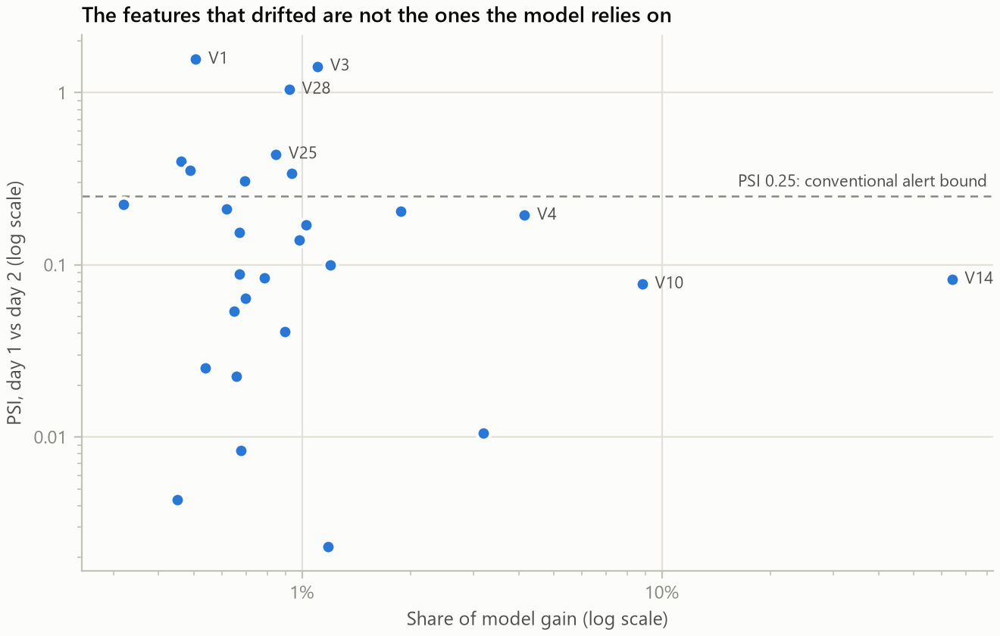
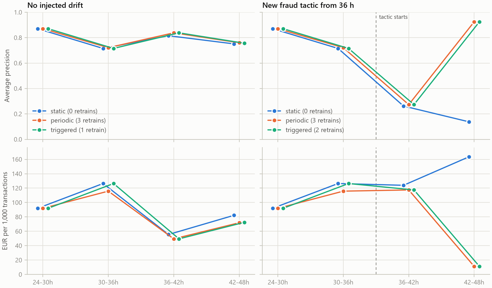

# Fraud detection that knows when it is going stale

Write-up for the fraud and anomaly detection brief. Every number below comes from [reports/summary.md](reports/summary.md); [README.md](README.md) explains how to regenerate it.

## Summary

- LightGBM with no rebalancing is the best detector: PR-AUC 0.785 on the test window (95% interval 0.70 to 0.85). Isolation Forest and an autoencoder score 0.06 and 0.05 on the same data while showing a ROC-AUC of 0.95.
- The dataset has real drift between its two days. Most of it is harmless, and a monitor that counts drifted features would have asked for a retrain for the wrong reason.
- The monitor here raised no alarm in 40 drift-free checks, warned on drift the model ignores, and flagged a retrain on drift that hurt. A change in fraud tactics was invisible until labels arrived.
- Retraining when flagged recovered a simulated tactic change in one window and cut total cost by 37%.

## Approach

The data is 48 hours of card payments: 284,807 rows, 492 frauds. I train on day 1, choose the threshold on hours 24 to 36 and report on hours 36 to 48, so nothing from the future reaches training. A shuffled split would have flattered the same model, 0.857 against 0.785. Features are the 28 PCA components and log amount. Raw time is left out because it drifts by construction.

The monitor compares each 6-hour window with the same hours of day 1. Fraud rate, feature values and accuracy all follow the clock (fraud is 0.45% to 0.60% of payments in the first six hours of each day and 0.08% to 0.26% afterwards), so comparing a window with the whole-day average reports the time of day as drift.

## Key decisions

**Imbalance: leave the data alone and constrain the model.** Test PR-AUC, with how far predicted fraud probability overshoots the observed rate:

| Strategy | LightGBM | LightGBM predicted / observed | Logistic regression |
|---|---|---|---|
| None | 0.789 | 1.1 | 0.574 |
| Class weights | 0.794 | 3.1 | 0.677 |
| SMOTE | 0.746 | 7.2 | 0.660 |
| Undersampling | 0.749 | 53.6 | 0.374 |

Rebalancing helps the weak model and not the strong one, as Elor and Averbuch-Elor (2022) found. Class weights tie on ranking but triple the predicted fraud rate, and the cost rule below needs honest probabilities, so I kept the unweighted model. The imbalance bites elsewhere: LightGBM with library defaults collapses to 0.056, so its learning rate and leaf size are held down.

**PR-AUC, not ROC-AUC, and supervised over unsupervised.** With 0.12% fraud, a 1% false-positive rate means about 925 false alarms against 115 frauds. ROC-AUC barely registers that.

| Model, test window | PR-AUC (95% interval) | ROC-AUC |
|---|---|---|
| LightGBM | 0.785 (0.703 to 0.854) | 0.979 |
| Logistic regression, class-weighted | 0.677 (0.590 to 0.767) | 0.937 |
| Isolation Forest | 0.057 (0.042 to 0.077) | 0.949 |
| Autoencoder, fitted on legitimate payments | 0.050 (0.039 to 0.065) | 0.956 |

The unsupervised detectors are not useless, they are time-dependent: PR-AUC 0.53 to 0.73 in the first six hours of each day, and 0.04 to 0.16 in the afternoon and evening, when volume is about four times higher and unusual but honest payments fill the top of the ranking.

**Threshold from costs, with the fragility stated.** I assumed a missed fraud costs its amount plus EUR 20 of handling, a blocked legitimate payment EUR 5, and a correctly blocked fraud EUR 1. Minimising cost on validation gives a threshold of 0.0085. On test it catches 95 of 115 frauds with 456 false alarms and removes 66% of the cost of having no model (EUR 6,289 against 18,713).

The cost curve is nearly flat between 0.01 and 0.6. A threshold of 0.5 costs about 1% more with 15 false alarms instead of 456, and pricing a false alarm at EUR 10 moves the optimum to 0.62. Whoever owns the false-alarm cost owns this decision. A rule that weighs each payment's amount against its calibrated fraud probability beats any single threshold: 72% saved with 111 false alarms.

**Alerting on what reaches the model, not on what moved.** The monitor reads four signals per window: feature PSI together with the share of model importance sitting on drifted features; PSI of the model's score and the alert rate against reference; the anomaly rate from the unsupervised detectors; and, once labels arrive, PR-AUC against reference at a common fraud rate with a bootstrap interval.

Feature drift alone only warns. A retrain flag needs one of three things:

- **R1:** a PR-AUC drop of 15% or more whose interval excludes zero, on at least 25 frauds.
- **R2:** score PSI of 0.25 or more, or an alert rate outside half to double the reference, two windows running.
- **R3:** 25% or more of model importance on drifted features, together with a milder shift in the output.

KS p-values are not used: all 29 features are "significant" at this sample size.

## Results

### The real later window

Eight of 29 features cross the usual PSI bound of 0.25, and they hold 6% of the model's importance. The output still moved:

| Hours | Features over 0.25 | Score PSI | Alerts / reference | Precision | Recall | Without labels | With labels |
|---|---|---|---|---|---|---|---|
| 24 to 30 | 11 | 0.107 | 1.68 | 0.44 | 0.93 | WARN | WARN |
| 30 to 36 | 8 | 0.205 | 1.15 | 0.11 | 0.81 | WARN | RETRAIN (R1) |
| 36 to 42 | 8 | 0.197 | 2.32 | 0.17 | 0.86 | WARN | RETRAIN (flag open) |
| 42 to 48 | 10 | 0.178 | 2.70 | 0.18 | 0.79 | RETRAIN (R2) | RETRAIN |

Was the flag right? Replaying day 2 says yes, modestly. Retraining every window cut total cost by 9% (EUR 10,763 against 11,887). Retraining only when flagged cut it by 6% with one retrain instead of three. The gain came from fewer false alarms (389 against 720), not from catching more fraud.

### Injected drift

Day 2 is not a clean control, so the scenarios run on a drift-free test bed: the model is refitted on a random half of day 1 and monitors the other half. The table shows the first injected window.

| Scenario | Max feature PSI | Score PSI | Alerts / reference | Precision | Recall | Without labels | With labels |
|---|---|---|---|---|---|---|---|
| S0 nothing injected | 0.00 | 0.023 | 1.05 | 0.49 | 0.84 | OK | OK |
| S1 one-SD shift on the least-used feature | 4.04 | 0.020 | 1.09 | 0.49 | 0.86 | WARN | WARN |
| S2 one-SD shift on the key feature, toward fraud | 2.23 | 1.065 | 2.27 | 0.23 | 0.86 | RETRAIN | RETRAIN |
| S3 fraud volume times four | 0.00 | 0.024 | 2.61 | 0.80 | 0.85 | WARN, then RETRAIN | WARN, then RETRAIN |
| S4 new tactic, 70% of frauds change signature | 0.00 | 0.023 | 0.73 | 0.27 | 0.32 | OK | RETRAIN |

- **S1 and S2 are the same shift on different features.** One warns and one flags a retrain, which is what weighting by importance is for.
- **S3 cannot be told from a false-alarm surge without labels.** With them, precision of 0.80 shows an attack to act on rather than a model to replace.
- **S4 moves no label-free signal.** It changes under 0.1% of rows. Injected into day 2, LightGBM caught 1 of 83 such frauds, Isolation Forest ranked 21 in its top 0.5% and the autoencoder none.

With labels arriving one window late, retraining on the flag took PR-AUC from 0.27 back to 0.93 in the next window and cut total cost by 37% against never retraining (EUR 11,906 against 18,774), with two retrains against three for the periodic policy.

## What I got wrong

- **Day 2 as a quiet control.** It was not, and the injections had to move to a drift-free test bed.
- **A key-feature shift away from fraud would only warn.** At one SD or more the monitor flags a retrain even though precision rose from 0.46 to 0.78. Without labels it sees that the output moved, not whether that was good.
- **The unsupervised detectors as the safety net for new tactics.** Isolation Forest caught a quarter. The autoencoder caught none at four SDs and 9 of 83 at eight.
- **The first performance check.** It compared each window with the day-1 average and raised 5 false alarms in 40 control checks, because accuracy follows the clock too. Comparing like with like brought that to zero.

## Limits

- **Two days of data.** One training day cannot fully separate a daily cycle from drift, and each window holds 27 to 91 frauds, so intervals are wide.
- **Labels are assumed to arrive within six hours.** Real chargebacks take days or weeks, and in that gap only the label-free signals exist, which miss a tactic change.
- **Costs are assumptions.** The threshold conclusion depends on them; the sensitivity grid is in the summary.
- **The scenarios are constructed.** S4 is built to exploit the model's blind spot and is easy to learn once labelled.
- **The performance reference is optimistic.** It comes from shuffled out-of-fold scores, so R1 leans toward firing.
- **Alert bounds are conventions.** They were checked against controls, not optimised.
